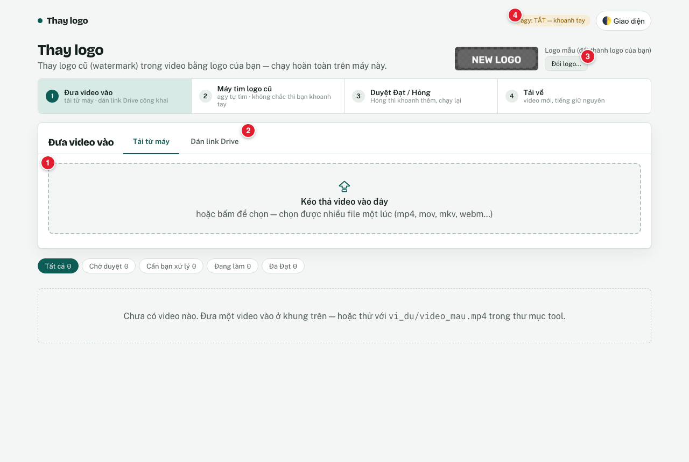

# Hướng dẫn cài đặt (máy Mac)

Làm **một lần**. Mất khoảng 15–30 phút trên máy mới. Không cần biết code: chỉ cần copy lệnh, dán vào Terminal, bấm Enter.

> Mẹo: mỗi khung xám bên dưới là **một lệnh**. Bấm nút copy ở góc khung (hoặc bôi đen rồi Cmd+C), dán vào Terminal (Cmd+V), bấm **Enter**.

---

## Bước 1. Mở Terminal

1. Bấm **Cmd + Space** (mở Spotlight).
2. Gõ `Terminal`, bấm **Enter**.

**Kết quả đúng:** một cửa sổ chữ hiện ra, dòng cuối có dạng `tenban@MacBook ~ %`. Đây là nơi bạn dán lệnh.

**Cách "đi vào" một thư mục (lệnh `cd`):** gõ `cd ` (chữ cd và **một dấu cách**), rồi **kéo thả thư mục** từ Finder vào cửa sổ Terminal. Đường dẫn tự hiện ra. Bấm **Enter**.

---

## Bước 2. Cài Homebrew (trình cài phần mềm)

Kiểm xem máy đã có chưa:
```bash
brew --version
```
- Ra dòng `Homebrew 4.x` (hoặc số khác) → **đã có**, sang Bước 3.
- Ra `command not found: brew` → cài bằng lệnh chính thức:

```bash
/bin/bash -c "$(curl -fsSL https://raw.githubusercontent.com/Homebrew/install/HEAD/install.sh)"
```
- Terminal hỏi **Password**: gõ mật khẩu đăng nhập máy Mac rồi Enter. **Lúc gõ không hiện ký tự nào** — bình thường, cứ gõ.
- Bấm **Enter** khi nó hỏi "Press RETURN to continue".
- Chờ 5–15 phút.

**Kết quả đúng:** cuối cùng có chữ `Installation successful!` và mục **"Next steps"** với 2 dòng lệnh. **Copy và chạy đúng 2 dòng đó** (trên Mac chip Apple chúng có dạng `echo >> ... ` và `eval "$(/opt/homebrew/bin/brew shellenv)"`). Sau đó chạy lại `brew --version` phải ra số phiên bản.

---

## Bước 3. Có git chưa?

```bash
git --version
```
- Ra `git version 2.x` → xong.
- Máy hiện hộp thoại "cài công cụ dòng lệnh" (Command Line Tools) → bấm **Install**, chờ xong rồi chạy lại lệnh trên. (Homebrew ở Bước 2 thường đã cài sẵn git.)

---

## Bước 4. Lấy code về máy

Repo là **riêng tư**: bạn phải được mời vào repo trên GitHub trước. Chọn **một** trong hai cách.

### Cách A — dùng git (khuyên dùng, dễ cập nhật về sau)

Cài công cụ GitHub và đăng nhập (một lần):
```bash
brew install gh
gh auth login
```
Chọn `GitHub.com` → `HTTPS` → `Login with a web browser`. Terminal in ra một mã 8 ký tự; trình duyệt mở, dán mã, bấm **Authorize**.

**Kết quả đúng:** Terminal báo `✓ Logged in as <tên-github-của-bạn>`.

Tải code về thư mục nhà:
```bash
cd ~
gh repo clone namhd-SG/thay-logo-video
cd thay-logo-video
```
(Hoặc `git clone https://github.com/namhd-SG/thay-logo-video.git` — khi git hỏi mật khẩu, **không** dùng mật khẩu GitHub mà dùng token; vì vậy cách `gh` ở trên dễ hơn.)

**Kết quả đúng:** có thư mục `thay-logo-video` trong thư mục nhà, gõ `ls` thấy `cai-dat.sh`, `mo-tool.command`, `README.md`.

### Cách B — tải file ZIP

1. Mở trang repo trên GitHub → nút xanh **Code** → **Download ZIP**.
2. Nhấp đúp file ZIP để giải nén. Kéo thư mục ra chỗ dễ tìm (ví dụ thư mục nhà).
3. Gỡ "cờ chặn" của macOS cho cả thư mục (gõ `xattr -dr com.apple.quarantine `, có dấu cách cuối, rồi **kéo thả thư mục** vào Terminal, Enter):
```bash
xattr -dr com.apple.quarantine ~/thay-logo-video-main
```
4. Đi vào thư mục: gõ `cd ` rồi kéo thả thư mục vào Terminal, Enter.

---

## Bước 5. Cài tool

Đứng trong thư mục tool (Bước 4), chạy:
```bash
bash cai-dat.sh
```
Script tự kiểm và cài: Python 3.11+ và ffmpeg (qua Homebrew), rồi tạo môi trường riêng `.venv` và cài tool vào đó. **Không cần mật khẩu, không đụng phần còn lại của máy.** Chạy lại bao nhiêu lần cũng được.

**Kết quả đúng** (số phiên bản có thể khác):
```
1/6  Máy Mac
  ✓ macOS 15.7
2/6  Homebrew (trình cài phần mềm)
  ✓ Homebrew 4.x
3/6  Python 3.11 trở lên
  ✓ Python 3.12.x (/opt/homebrew/bin/python3.12)
4/6  ffmpeg (xử lý video, cần bộ mã hoá libx264)
  ✓ ffmpeg 7.x có libx264 (/opt/homebrew/bin/ffmpeg)
5/6  Cài tool vào thư mục .venv ...
  ✓ .venv sẵn sàng (Python 3.12.x)
  ✓ Đã cài tool (lệnh thay-logo chạy được)
6/6  agy (tuỳ chọn — để tool TỰ TÌM logo cũ)
  ! Chưa có agy trên máy.        ← dòng vàng này KHÔNG phải lỗi
✓ Cài xong. Mở tool: nhấp đúp file mo-tool.command trong thư mục này
```
- Dòng **✗ đỏ** = có bước hỏng: làm đúng lời dặn ngay dưới dòng đó, rồi chạy lại `bash cai-dat.sh`.
- Dòng **! vàng** ở bước agy = máy chưa có agy. Tool vẫn chạy, chỉ là bạn sẽ khoanh logo cũ bằng chuột (xem Bước 11).

---

## Bước 6. Mở tool

Trong Finder, vào thư mục tool, **nhấp đúp `mo-tool.command`**.

- Lần đầu macOS có thể chặn: xem mục **"Lỗi thường gặp"** bên dưới (chuột phải → Open).
- Một cửa sổ Terminal mở ra, in `=== Thay logo video ===` và `Đang mở http://127.0.0.1:8790 …`.

**Kết quả đúng:** trình duyệt tự mở trang **Thay logo** ở địa chỉ:
```
http://127.0.0.1:8790
```
Nếu trình duyệt không tự mở, copy địa chỉ trên dán vào thanh địa chỉ.



**Để cửa sổ Terminal đó MỞ** suốt lúc dùng tool. Cách dùng tool: xem [Hướng dẫn sử dụng](HUONG-DAN-SU-DUNG.md).

---

## Bước 7. Lần sau mở lại

Chỉ cần **nhấp đúp `mo-tool.command`**. Không cần cài lại.
Nếu tool đang mở sẵn, file này chỉ mở trình duyệt, không bật thêm bản thứ hai.

## Bước 8. Tắt tool

Bấm vào cửa sổ Terminal của tool rồi bấm **Ctrl + C** (hoặc đóng cửa sổ Terminal đó). Video và kết quả vẫn giữ trong thư mục `data/`.

## Bước 9. Cập nhật bản mới

**Nếu lấy code bằng git (Cách A):** tắt tool, mở Terminal, rồi:
```bash
cd ~/thay-logo-video
git pull
bash cai-dat.sh
```
**Kết quả đúng:** `git pull` báo `Already up to date.` hoặc liệt kê file thay đổi; `cai-dat.sh` kết thúc bằng `✓ Cài xong.`

**Nếu dùng ZIP (Cách B):** tải ZIP bản mới, giải nén, chạy `xattr -dr com.apple.quarantine` cho thư mục mới (như Bước 4B), rồi **chép thư mục `data/`** từ thư mục cũ sang thư mục mới (để giữ video và kết quả cũ). Sau đó chạy `bash cai-dat.sh` trong thư mục mới.

## Bước 10. agy (tuỳ chọn) — để tool tự tìm logo cũ

agy (Antigravity CLI) giúp tool **tự tìm** logo cũ trong video. Cài và đăng nhập agy theo hướng dẫn của Antigravity. Kiểm:
```bash
agy models
```
**Kết quả đúng:** in ra danh sách tên model (có dòng bắt đầu bằng `gemini-`). Chạy lại `bash cai-dat.sh`: bước 6/6 phải hiện **✓ agy chạy được**. Mở lại tool: chip góc phải trên trang ghi **"agy: tự tìm BẬT"**.

Lưu ý: khi bật agy, mỗi video gửi **7 ảnh khung hình thu nhỏ** qua dịch vụ của agy. Video không được gửi ra ngoài thì dùng tool không có agy.

## Bước 11. Không có agy thì sao?

Không sao. Chip trên trang ghi **"agy: TẮT — khoanh tay"**. Mỗi video mới sẽ chờ bạn **khoanh logo cũ bằng chuột** ở vài khung hình (mất khoảng 1 phút). Mọi việc khác chạy như thường. Xem [Hướng dẫn sử dụng](HUONG-DAN-SU-DUNG.md), mục "Khoanh logo cũ".

---

## Lỗi thường gặp

| Thấy chữ | Làm |
|---|---|
| `command not found: brew` | Chưa cài Homebrew, hoặc chưa chạy 2 dòng "Next steps". Làm lại Bước 2. Nếu đã cài: chạy `eval "$(/opt/homebrew/bin/brew shellenv)"` (Mac chip Intel: `eval "$(/usr/local/bin/brew shellenv)"`). |
| `command not found: python3` | Chạy `bash cai-dat.sh` — script tự cài Python qua Homebrew. |
| `command not found: thay-logo` | Đừng gõ lệnh trần. Mở tool bằng **nhấp đúp `mo-tool.command`**. Muốn gõ lệnh thì dùng `.venv/bin/thay-logo` trong thư mục tool. Chưa có `.venv` thì chạy `bash cai-dat.sh`. |
| `✗ Cổng 8790 đang bị một chương trình khác dùng` | Mở Terminal trong thư mục tool, chạy: `CONG=8791 ./mo-tool.command`, rồi mở `http://127.0.0.1:8791`. |
| Bước Python báo bản cũ (ví dụ `3.9`) | Python sẵn của macOS quá cũ. `bash cai-dat.sh` tự cài `python@3.12` và tự tạo lại `.venv`. Vẫn lỗi: `brew install python@3.12` rồi chạy lại script. |
| `ffmpeg vẫn thiếu libx264` | Chạy `brew reinstall ffmpeg` rồi `bash cai-dat.sh`. |
| *"mo-tool.command" không thể mở vì nhà phát triển không xác định* | **Chuột phải** vào `mo-tool.command` → **Open (Mở)** → **Open**. Chỉ cần 1 lần. Hoặc trong Terminal: `xattr -dr com.apple.quarantine ` rồi kéo thả thư mục tool vào, Enter. |
| `Permission denied` khi mở `mo-tool.command` | Trong Terminal, đứng ở thư mục tool: `chmod +x mo-tool.command` |
| `✗ Chưa cài. … chạy: bash cai-dat.sh` | Chưa có `.venv`. Làm Bước 5. |
| Trang báo **"Mất kết nối tới máy chủ"** | Cửa sổ Terminal của tool đã bị đóng hoặc bấm Ctrl+C. Nhấp đúp `mo-tool.command` lại, rồi tải lại trang. |
| Chip ghi **"agy: TẮT"** dù đã cài agy | Kiểm `agy models` trong Terminal. Lỗi đăng nhập thì đăng nhập lại agy. Lệnh `agy` không có thì xem lại Bước 10. Không cần agy vẫn dùng được (khoanh tay). |
| `cai-dat.sh` báo `Cài gói không được` | Thường do mất mạng giữa chừng. Kiểm mạng rồi chạy lại `bash cai-dat.sh`. |
