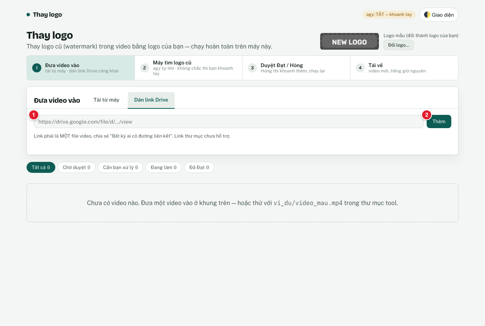
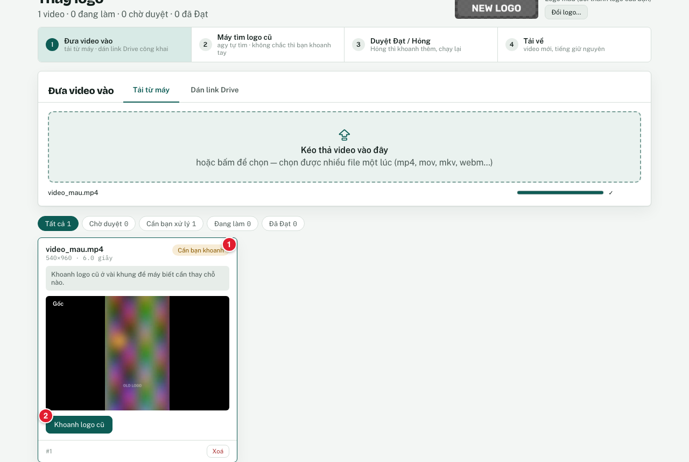
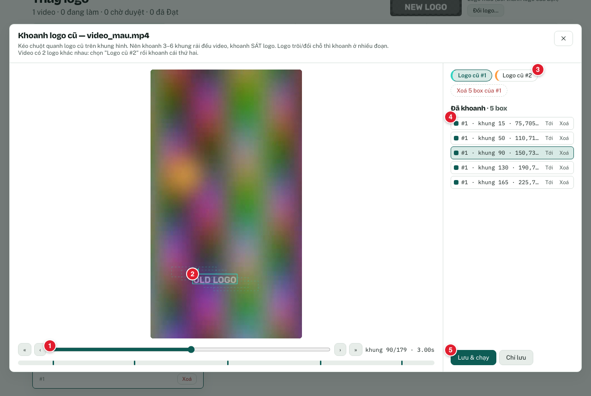
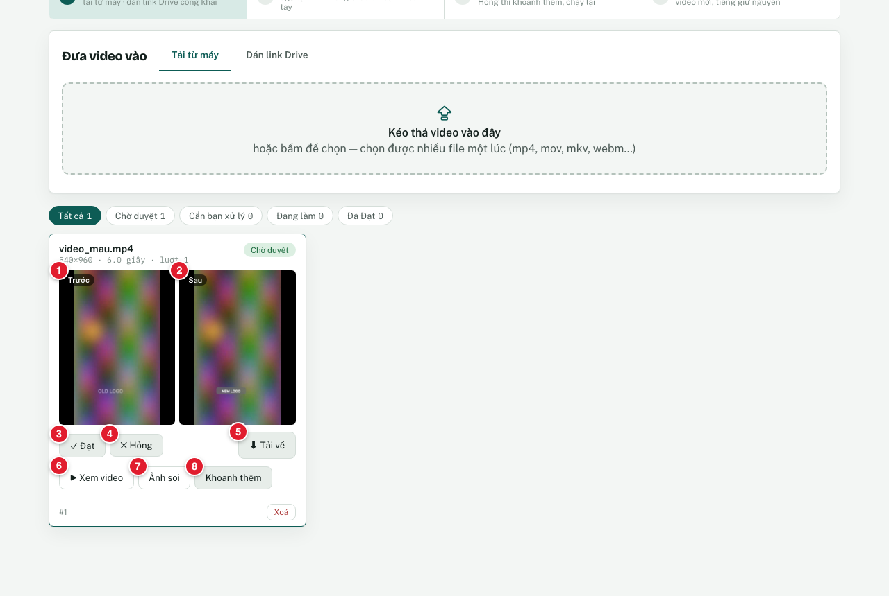
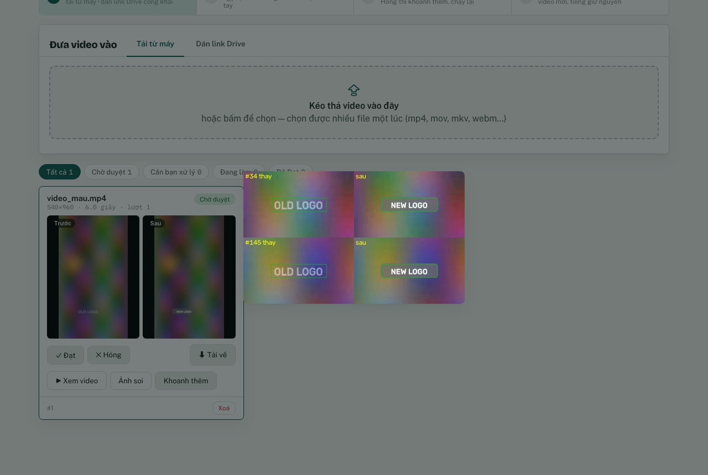
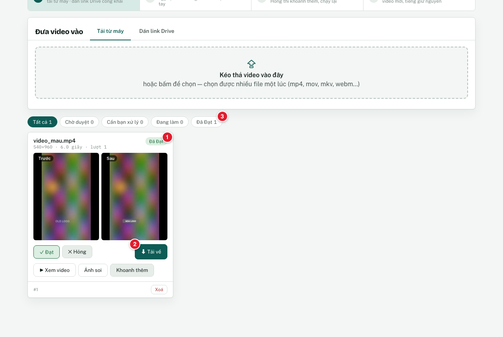
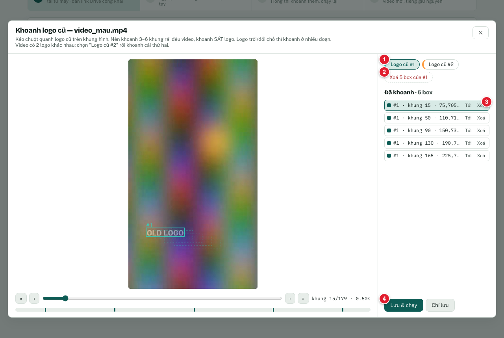
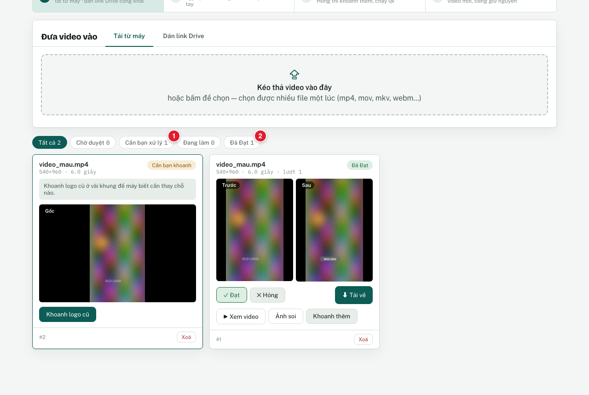

# Hướng dẫn sử dụng

Chưa cài? Xem [Hướng dẫn cài đặt](HUONG-DAN-CAI-DAT.md) trước.

Mở tool: **nhấp đúp `mo-tool.command`** → trình duyệt mở `http://127.0.0.1:8790`. Để cửa sổ Terminal của tool mở suốt lúc dùng.

Muốn thử ngay: dùng video mẫu đi kèm `vi_du/video_mau.mp4` (video tổng hợp 6 giây, có chữ "OLD LOGO" trôi chậm). Mọi ảnh dưới đây chụp từ đúng video đó.

Các số đỏ ①②③ trên ảnh chỉ đúng nút đang nói tới.

---

## 1. Đưa video vào


| Muốn | Bấm | Thấy |
|---|---|---|
| Đưa video từ máy | Kéo thả file video vào khung **①** "Kéo thả video vào đây" (hoặc bấm vào khung để chọn file; chọn được nhiều file) | Thanh tiến độ, rồi một thẻ video mới hiện bên dưới |
| Đưa video từ Google Drive | Tab **②** "Dán link Drive" | Ô dán link (ảnh dưới) |
| Đổi logo mới | **③** "Đổi logo…" | Xem mục 6 |
| Biết agy có bật không | Xem chip **④** | "agy: tự tìm BẬT" hoặc "agy: TẮT — khoanh tay" |



Dán link vào ô **①** → bấm **②** "Thêm". Link phải là **một file video**, chia sẻ "Bất kỳ ai có đường liên kết". Link thư mục chưa hỗ trợ.

## 2. agy tự tìm logo cũ

- **agy BẬT:** thẻ hiện "agy đang tìm…" (thường 30 giây – vài phút). Tìm thấy → tool **tự thay logo luôn**, thẻ chuyển sang "Chờ duyệt" (mục 4).
- **agy TẮT, hoặc agy không chắc:** thẻ hiện **"Cần bạn khoanh"** → làm mục 3.



Chip **①** "Cần bạn khoanh" → bấm **②** "Khoanh logo cũ".

## 3. Khoanh logo cũ (bằng chuột)



1. Kéo thanh thời gian **①** tới chỗ có logo cũ (hoặc phím ← →; giữ Shift để nhảy 10 khung).
2. **Kéo chuột** thành khung chữ nhật **sát** quanh logo cũ **②**. Khoanh lại trên cùng khung = thay khung cũ.
3. Lặp lại ở **3–6 khung rải đều** video. Viền đứt nét = box ở các khung khác (thấy logo trôi tới đâu).
4. Video có **2 logo cũ khác nhau**: bấm **③** "Logo cũ #2" rồi khoanh cái thứ hai.
5. Danh sách **④** cho thấy các box đã khoanh ("Tới" = nhảy tới khung đó, "Xoá" = bỏ box).
6. Bấm **⑤** "Lưu & chạy". ("Chỉ lưu" = lưu box, chưa chạy.)

Video mẫu 6 giây chạy xong trong khoảng **10 giây**.

## 4. Đọc thẻ kết quả và duyệt Đạt / Hỏng



| Số | Nút / ảnh | Dùng để |
|---|---|---|
| ① | Ảnh **Trước** | Khung gốc. Bấm để xem to. |
| ② | Ảnh **Sau** | Cùng khung đó sau khi thay. So với ①. |
| ③ | **✓ Đạt** | Bản ra ổn → bấm. |
| ④ | **✕ Hỏng** | Logo cũ còn lộ, hoặc dán nhầm chỗ → bấm, rồi sửa (mục 5). |
| ⑤ | **⬇ Tải về** | Tải video kết quả (mục 7). |
| ⑥ | **▶ Xem video** | Xem cả video kết quả ngay trên thẻ. |
| ⑦ | **Ảnh soi** | Xem vài khung đã thay (và khung bị chặn, nếu có). |
| ⑧ | **Khoanh thêm** | Mở lại màn khoanh để sửa box rồi chạy lại. |

Bấm **⑦ Ảnh soi** → thấy ảnh ghép: bên trái khung gốc (khung xanh = chỗ máy thay), bên phải sau khi thay. Bấm vào ảnh để đóng.



**Luôn xem Trước/Sau và Ảnh soi trước khi bấm Đạt.** Tool có luật an toàn: khung nào chưa đủ chắc thì **không đè** (thà sót logo cũ còn hơn dán lên nội dung sạch).

Bấm **Đạt** xong: chip **①** thành "Đã Đạt", nút **②** "Tải về" chuyển màu đậm, bộ lọc **③** "Đã Đạt" tăng số.



## 5. Khoanh thêm, xoá box sai, chạy lại

Muốn sửa (bấm Hỏng, hoặc thẻ "Không chắc") → bấm **Khoanh thêm** → màn khoanh mở lại, có sẵn các box cũ.



| Muốn | Bấm |
|---|---|
| Chọn nhóm logo đang sửa | **①** "Logo cũ #1" (hoặc #2) |
| Xoá **cả nhóm** box (ví dụ agy khoanh nhầm cả một vật) | **②** "Xoá N box của #1" |
| Xoá **một** box sai | **③** "Xoá" ở dòng box đó |
| Khoanh thêm chỗ logo cũ còn lộ | Kéo thanh thời gian tới đó, kéo chuột quanh logo |
| Chạy lại | **④** "Lưu & chạy" — tool chạy lượt mới từ video gốc ("lượt 2", "lượt 3"…) |

**Ví dụ thật: agy khoanh nhầm hình tròn.** Trong một lần thử, agy coi một hình tròn màu (nội dung video, không phải logo) là "Logo cũ #1", nên bản ra bị dán logo mới lên hình tròn. Cách sửa: **Khoanh thêm** → chọn **"Logo cũ #1"** → bấm **"Xoá 6 box của #1"** → **"Lưu & chạy"**. Lượt 2 chỉ thay đúng logo cũ.


## 6. Đổi logo mới

Muốn dùng logo của bạn → bấm **"Đổi logo…"** (góc trên phải, số ③ ở ảnh mục 1) → chọn file **PNG nền trong suốt** → ô logo hiện logo mới, chữ đổi thành "Logo mới của bạn".

- Logo mới áp cho các lượt chạy **từ lúc đổi**. Video đã xong muốn áp logo mới: **Khoanh thêm** → **Lưu & chạy**.
- **"Dùng logo mẫu"** để quay về logo mẫu.
- Nên dùng logo có **tấm nền mờ** phía sau chữ (như logo mẫu): che luôn vết tô nền, nhìn sạch hơn.
- Logo được co vừa chỗ logo cũ, giữ tỉ lệ, đặt giữa.

## 7. Tải về

Bấm **"⬇ Tải về"** trên thẻ → trình duyệt tải file `<tên gốc>_thay_logo.mp4` (thường vào thư mục Downloads). Video dạng H.264, giữ nguyên tiếng, cùng kích thước và cùng số khung với gốc. Video gốc không bị sửa.

## 8. Xử lý nhiều video

- Kéo thả **nhiều file một lúc** vào khung "Kéo thả video vào đây". Mỗi video một thẻ.
- Tool xử lý **lần lượt từng video**; video chờ hiện "Đang chờ tới lượt…".
- Dùng bộ lọc trên danh sách để tìm việc cần làm:



**①** "Cần bạn xử lý" = video chờ bạn khoanh, "Không chắc", lỗi, hoặc đã chấm Hỏng. **②** "Đã Đạt" = video bạn đã duyệt xong. Ngoài ra có "Chờ duyệt" và "Đang làm".

- Nút **"Xoá"** ở chân thẻ xoá video đó cùng mọi kết quả của nó.

## 9. Dòng lệnh (tuỳ chọn)

Không cần cho việc hằng ngày. Ai thích Terminal: đứng trong thư mục tool, dùng `.venv/bin/thay-logo`, ví dụ:
```bash
.venv/bin/thay-logo chay vi_du/video_mau.mp4 --boxes vi_du/boxes_mau.json --out ra.mp4
```
Đủ tham số: xem [README.md](README.md) mục 5.

## 10. Giới hạn và câu hỏi thường gặp

**Giới hạn**
- agy có thể khoanh nhầm vật trông giống logo (hình phẳng, icon). Luôn xem Trước/Sau và Ảnh soi trước khi bấm Đạt.
- Đoạn logo chồng lên phụ đề, logo mờ hẳn, hoặc nền biến động mạnh có thể **bị bỏ không thay**. Khoanh thêm đúng đoạn đó thường cứu được, không phải luôn luôn.
- Mọi logo cũ trong video đều nhận **cùng một** logo mới.
- Logo cũ rất nhỏ/dẹt thì logo mới cũng nhỏ theo.
- Mỗi lúc chỉ xử lý một video. Video mẫu 6 giây mất ~10 giây; video dài hoặc 4K lâu hơn tương ứng.
- Chỉ chạy trên máy bạn (`127.0.0.1`), không đăng nhập. Đừng mở cổng ra Internet.

**Câu hỏi thường gặp**

| Hỏi | Đáp |
|---|---|
| Video và kết quả nằm đâu? | Thư mục `data/` trong thư mục tool. Muốn dọn sạch: tắt tool, xoá `data/`. |
| Thẻ "Không chắc" là gì? | Máy chưa đủ bằng chứng nên **chưa thay** (giữ nguyên gốc). Bấm "Khoanh thêm": khoanh **sát** logo ở **nhiều khung hơn**, rải đều. |
| Bản ra còn lộ logo cũ một đoạn? | Tool cố ý không đè đoạn chưa chắc. "Khoanh thêm" ở đúng đoạn đó rồi chạy lại. |
| Trang báo "Mất kết nối tới máy chủ"? | Cửa sổ Terminal của tool đã đóng. Nhấp đúp `mo-tool.command` lại. |
| Có gửi video lên mạng không? | Không, trừ khi bật agy: khi đó agy nhận 7 ảnh khung hình thu nhỏ mỗi video. |
| Lỗi khác? | Xem mục "Lỗi thường gặp" trong [Hướng dẫn cài đặt](HUONG-DAN-CAI-DAT.md). |
