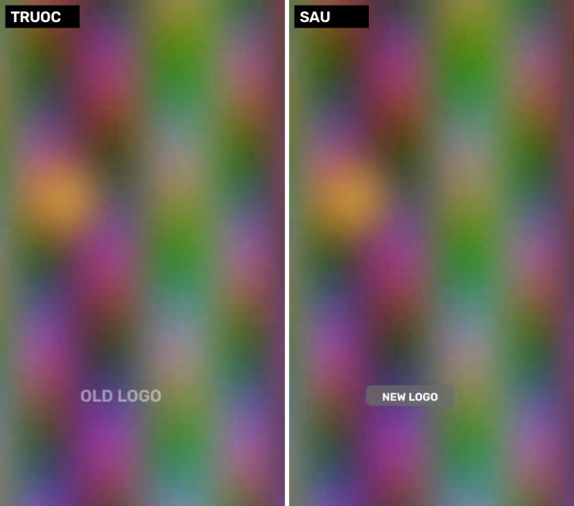
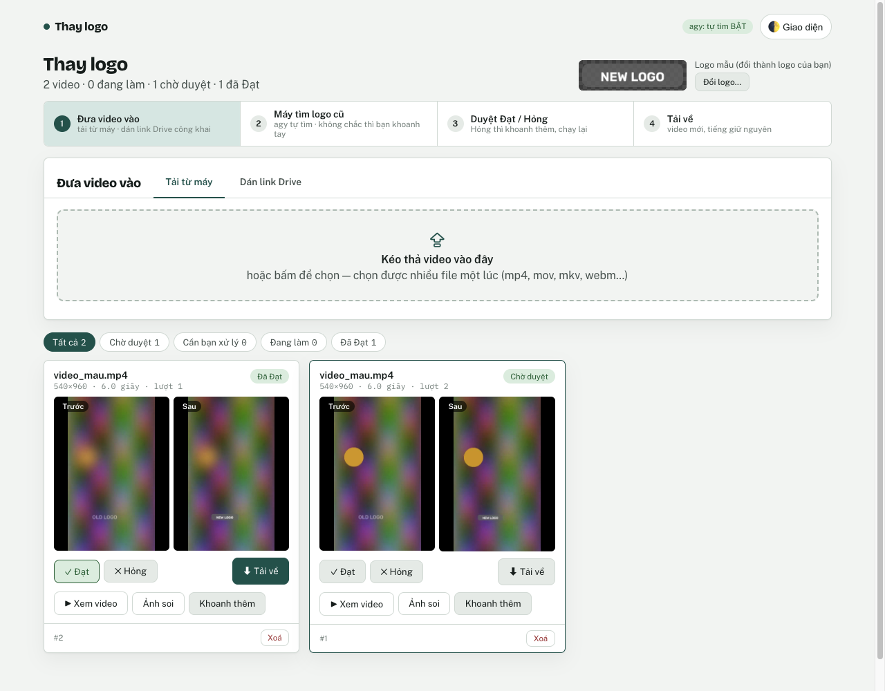
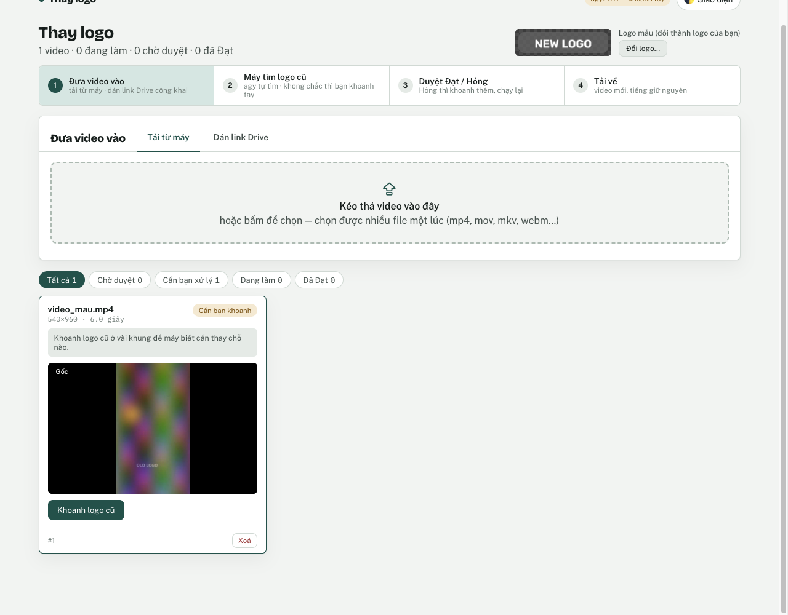
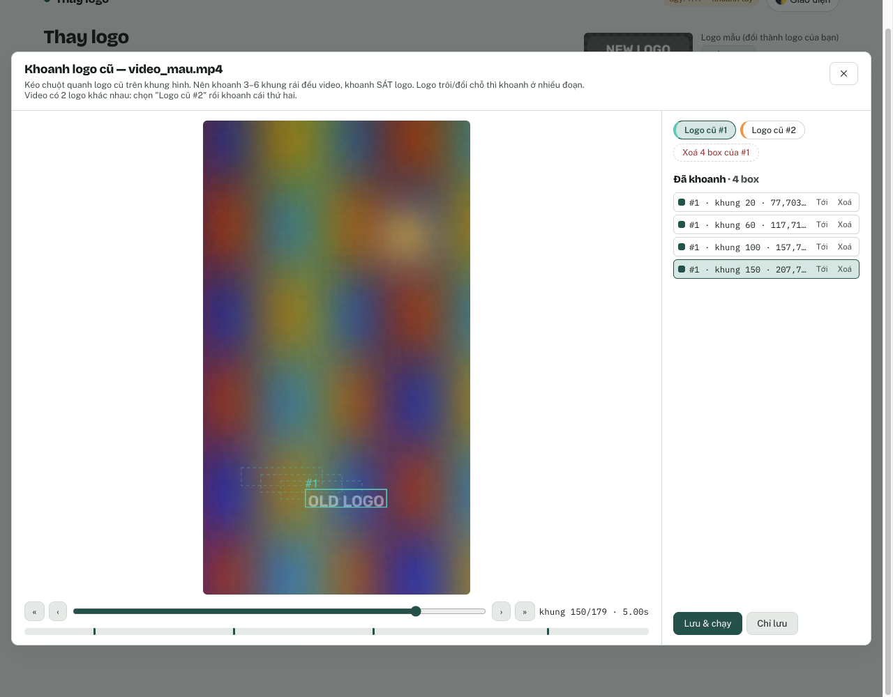
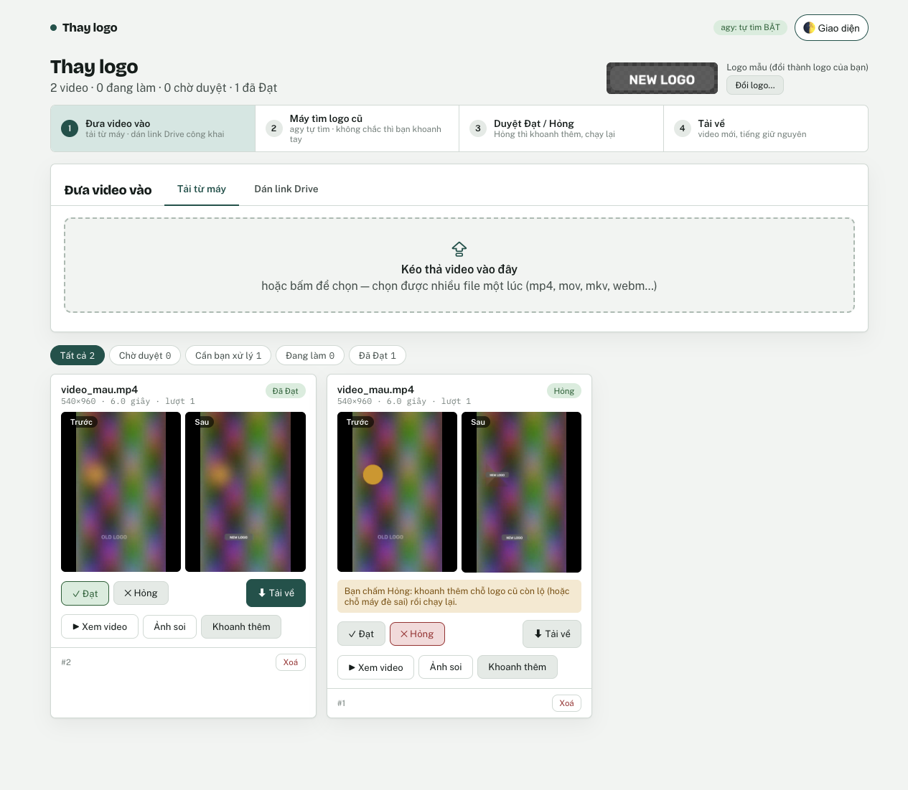
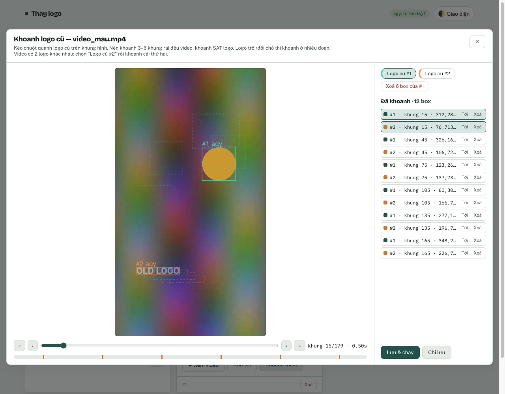
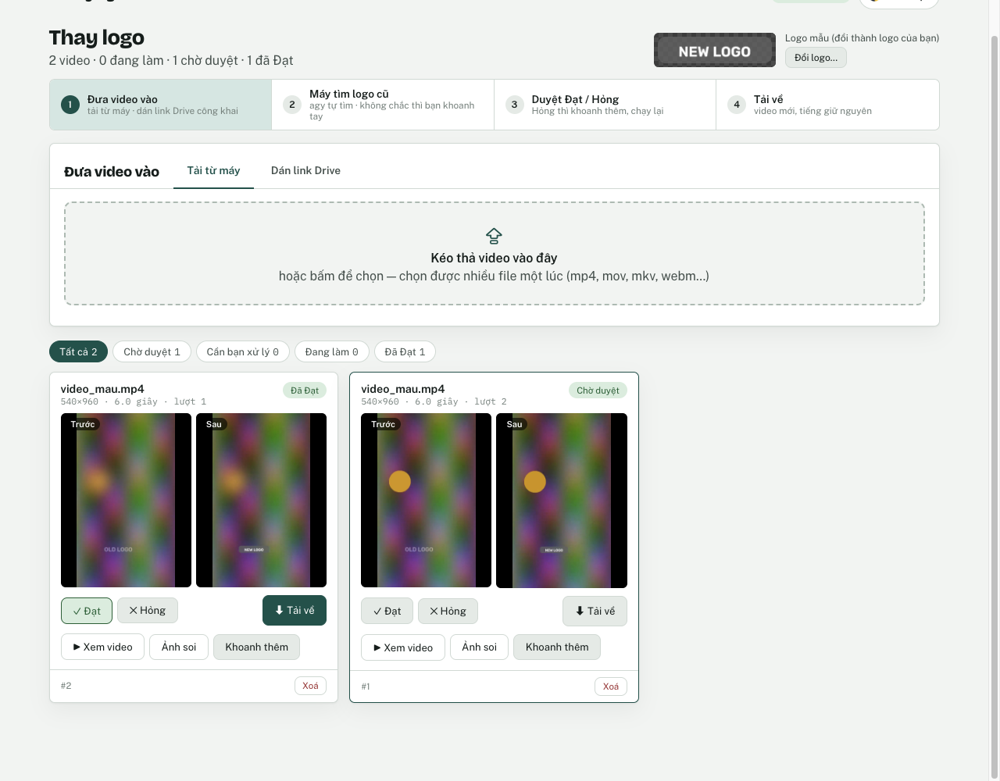

# Thay logo video

Tool thay **logo cũ / watermark** trong video bằng **logo của bạn**, kể cả logo trôi đổi chỗ theo thời gian. Mọi thứ chạy trên máy Mac của bạn, mở bằng trình duyệt ở địa chỉ `http://127.0.0.1:8790`. Không cần đăng nhập, không cần mạng (trừ khi bật tự tìm bằng agy hoặc dán link Drive).



Cách tool làm việc:
1. **Tìm logo cũ.** `agy` tự tìm trên vài khung hình. Nếu agy không chắc, bạn khoanh tay bằng chuột ngay trên trang.
2. **Bám theo logo cũ** trên từng khung, kể cả khi nó trôi.
3. **Xoá logo cũ** bằng nền thật lấy từ các khung lân cận, rồi **dán logo mới** vào đúng chỗ. Tiếng giữ nguyên, video gốc không bị sửa.
4. **Luật an toàn:** khung nào chưa đủ chắc thì **không đè**. Tool thà để sót logo cũ còn hơn dán logo lên nội dung sạch. Vì vậy luôn có bước **bạn duyệt Đạt / Hỏng** trước khi tải về.

---

## 1. Yêu cầu máy

| | |
|---|---|
| Hệ điều hành | **macOS** (đã thử trên Apple Silicon, macOS 15) |
| Python | **3.11 trở lên** (đã chạy thử với 3.14.7) |
| ffmpeg | bản có bộ mã hoá **libx264**. Bản `brew install ffmpeg` có sẵn. |
| agy *(tuỳ chọn)* | để tool **tự tìm** logo cũ. Không có agy thì bạn khoanh tay, mọi thứ khác vẫn chạy. |
| Đĩa / RAM | mỗi video cần chỗ trống khoảng 2–3 lần dung lượng của nó; RAM trống ~1 GB |

## 2. Cài đặt (làm một lần)

Mở **Terminal** rồi chạy lần lượt từng lệnh.

**2.1. Homebrew** (đã có thì bỏ qua; kiểm bằng `brew --version`):
```bash
/bin/bash -c "$(curl -fsSL https://raw.githubusercontent.com/Homebrew/install/HEAD/install.sh)"
```

**2.2. Python + ffmpeg:**
```bash
brew install python ffmpeg
python3 --version          # phải ra 3.11 trở lên
ffmpeg -hide_banner -encoders | grep libx264    # phải ra một dòng có chữ libx264
```

**2.3. Tải tool về** (thay `<link-repo>` bằng link repo bạn được mời vào):
```bash
cd ~
git clone <link-repo> thay-logo-video
cd thay-logo-video
```

**2.4. Tạo môi trường Python riêng và cài tool:**
```bash
python3 -m venv .venv
source .venv/bin/activate
pip install .
thay-logo --help           # ra danh sách lệnh là cài xong
```

> Từ đây, **mỗi lần mở Terminal mới** để dùng tool, chạy lại 2 lệnh này trước:
> `cd ~/thay-logo-video` rồi `source .venv/bin/activate`.

**2.5. agy (tuỳ chọn, nên có):** tool gọi lệnh `agy` (Antigravity CLI) có sẵn trên máy bạn. Cài và đăng nhập agy theo hướng dẫn của Antigravity, rồi kiểm tra:
```bash
agy models                 # phải in ra danh sách model, trong đó có gemini-3.8-flash-low
```
Nếu `agy models` báo lỗi, chưa đăng nhập, hoặc không có lệnh `agy`, tool vẫn chạy được: video mới sẽ chờ bạn khoanh tay (xem mục 4).

## 3. Dùng tool: trang web (cách chính)

```bash
cd ~/thay-logo-video
source .venv/bin/activate
thay-logo web
```
Trình duyệt tự mở `http://127.0.0.1:8790`. Cửa sổ Terminal phải **để mở** suốt lúc dùng; tắt tool bằng **Ctrl+C** trong Terminal đó. Dữ liệu (video, kết quả) nằm ở thư mục `data/` trong thư mục bạn đang đứng.

Muốn thử nhanh: dùng video mẫu đi kèm `vi_du/video_mau.mp4` (video tổng hợp 6 giây, có chữ "OLD LOGO" trôi chậm).

### Bước 1 — Đưa video vào
Kéo thả video vào khung **"Đưa video vào"**, hoặc bấm vào khung để chọn file. Chọn được nhiều file một lúc. Tab **"Dán link Drive"** nhận link **một file** Google Drive đang chia sẻ "Bất kỳ ai có đường liên kết".



### Bước 2 — Máy tìm logo cũ (hoặc bạn khoanh)
- **Có agy:** thẻ video hiện "agy đang tìm…" (thường 30 giây – vài phút). Tìm thấy thì tool **tự chạy thay logo luôn**.
- **Không có agy, hoặc agy không thấy:** thẻ hiện **"Cần bạn khoanh"** kèm lý do. Bấm **"Khoanh logo cũ"**.



Trong màn **Khoanh logo cũ**:
1. Kéo thanh thời gian (hoặc phím ← → ; giữ Shift để nhảy 10 khung) tới chỗ có logo cũ.
2. **Kéo chuột** thành khung chữ nhật **sát** quanh logo cũ.
3. Lặp lại ở **3–6 khung rải đều** video. Logo trôi hoặc đổi chỗ thì khoanh ở nhiều đoạn; viền đứt nét cho thấy các box ở khung khác.
4. Video có **2 logo cũ khác nhau**: bấm **"Logo cũ #2"** rồi khoanh cái thứ hai.
5. Bấm **"Lưu & chạy"**.



### Bước 3 — Duyệt Đạt / Hỏng
Xong, thẻ hiện ảnh **Trước / Sau** ở cùng một khung. Bấm vào ảnh để xem to. Có thêm **"▶ Xem video"** để xem cả video ra, và **"Ảnh soi"** để xem vài khung đã thay và vài khung bị chặn.
- Ổn: bấm **✓ Đạt**.
- Chưa ổn (logo cũ còn lộ, hoặc máy đè nhầm chỗ): bấm **✕ Hỏng** → **"Khoanh thêm"** → sửa → **"Lưu & chạy"**. Tool chạy lượt mới từ video gốc.



**Ví dụ thật: agy khoanh nhầm.** Trong một lần thử, agy coi một hình tròn màu (nội dung video, không phải logo) là logo #1, và bản ra bị dán logo mới lên hình tròn. Cách sửa: mở **"Khoanh thêm"**, chọn "Logo cũ #1", bấm **"Xoá 6 box của #1"**, rồi bấm "Lưu & chạy". Lượt 2 chỉ thay đúng logo cũ.




### Bước 4 — Tải về
Bấm **"⬇ Tải về"**. File tên `<tên gốc>_thay_logo.mp4`, dạng H.264, giữ nguyên tiếng, cùng kích thước và cùng số khung với gốc.

### Đổi logo mới
Góc trên phải trang có ô **"Logo mới đang dùng"**. Bấm **"Đổi logo…"** rồi chọn file **PNG nền trong suốt**. Logo áp cho các lượt chạy **từ lúc đổi**; video đã xong không tự đổi, muốn áp thì bấm "Khoanh thêm" → "Lưu & chạy". **"Dùng logo mẫu"** để quay về logo mẫu.

- Logo được **co vừa** vào chỗ logo cũ (nới thêm 4 px mỗi bên), giữ tỉ lệ, đặt giữa.
- Nên dùng logo có **tấm nền mờ** phía sau chữ, như logo mẫu `src/thay_logo/tai_nguyen/logo_mau.png`. Tấm nền che luôn vết tô nền, nhìn sạch hơn.
- Logo được lưu ở `data/logo.png`.

## 4. Cấu hình agy

| Muốn | Làm |
|---|---|
| Đổi model | `thay-logo web --agy-model gemini-3.8-flash-high`, hoặc đặt sẵn `export THAY_LOGO_AGY_MODEL=gemini-3.8-flash-high`. Xem tên model bằng `agy models`. Mặc định: `gemini-3.8-flash-low`. |
| agy nằm chỗ lạ | `thay-logo web --agy /duong/dan/agy`, hoặc `export THAY_LOGO_AGY=/duong/dan/agy` |
| Tắt tự tìm | `thay-logo web --khong-agy` (mọi video chờ khoanh tay) |
| Bỏ qua logo của chính bạn (đã có sẵn trong video) | `export THAY_LOGO_BO_QUA_NHAN=tenlogocuaban` (nhiều chữ thì cách nhau dấu phẩy): watermark nào agy đặt nhãn chứa chữ đó sẽ bị bỏ qua |

Dòng đầu Terminal khi chạy `thay-logo web` cho biết agy đang **BẬT** (kèm model) hay **TẮT**. Chip góc phải trên trang cũng ghi vậy.

**Dữ liệu gửi đi:** mỗi video, agy nhận **7 ảnh khung hình thu nhỏ (rộng 360 px)** để tìm logo. Các ảnh này đi qua dịch vụ của agy. Video có nội dung không được gửi ra ngoài thì chạy với `--khong-agy`.

## 5. Dòng lệnh (lối phụ, cho người thích Terminal)

```bash
# agy tự tìm rồi thay:
thay-logo chay vi_du/video_mau.mp4 --tu-tim --out ra.mp4

# Tự đưa box mồi (file JSON):
thay-logo chay vi_du/video_mau.mp4 --boxes vi_du/boxes_mau.json --out ra.mp4 --logo logo_cua_toi.png

# Tạo file box bằng cửa sổ kéo chuột (Enter = lưu khung đó, c = bỏ qua khung đó):
thay-logo chon-box video.mp4 --out boxes.json            # 5 khung rải đều
thay-logo chon-box video.mp4 --giay 1 3.5 7 --out boxes.json

# Máy không mở được cửa sổ: xuất ảnh khung, tự đo toạ độ (vd mở bằng Preview, xem số đo pixel):
thay-logo xuat-khung video.mp4 --thu-muc khung_xuat
```

**Mẫu `boxes.json`** (toạ độ **pixel của video gốc**, gốc toạ độ ở góc trên-trái; `khung` là số thứ tự khung hình, bắt đầu từ 0, có trong tên ảnh `xuat-khung` xuất ra):
```json
[
  {"khung": 15,  "x": 75,  "y": 705, "w": 159, "h": 35},
  {"khung": 90,  "x": 150, "y": 730, "w": 159, "h": 35},
  {"khung": 165, "x": 225, "y": 755, "w": 159, "h": 35, "cum": 0}
]
```
`cum` là tuỳ chọn: cùng số nghĩa là cùng một logo cũ. Video có 2 logo khác nhau thì đặt `cum` 0 và 1.

**Tham số `thay-logo chay`:**

| Tham số | Ý nghĩa |
|---|---|
| `video` | video gốc (mp4, mov, mkv…); không bị sửa |
| `--out` | file video ra (bắt buộc; không được trùng file gốc) |
| `--box KHUNG:X,Y,W,H` | một box mồi; lặp lại nhiều lần được |
| `--boxes FILE.json` | file box mồi |
| `--tu-tim` | không có box thì nhờ agy tìm |
| `--logo FILE.png` | logo mới (PNG nền trong suốt); mặc định là logo mẫu |
| `--bao-cao THU_MUC` | nơi ghi ảnh trước/sau, ảnh soi, track, nhật ký; mặc định `<tên ra>_bao_cao/` |
| `--crf` | chất lượng H.264, mặc định 18 (thấp hơn = nét hơn, file nặng hơn) |
| `--luong` | số luồng CPU, mặc định 2 |
| `--agy`, `--agy-model`, `--ffmpeg` | như mục 4 / biến `THAY_LOGO_FFMPEG` |

Mã thoát: `0` = đã thay và ghi file · `2` = **không thay** (chưa đủ chắc, không ghi file; lý do ở trường `ly_do`) · `1` = lỗi.

**Tham số `thay-logo web`:** `--cong` (mặc định 8790) · `--data` (mặc định `./data`) · `--khong-mo` (không tự mở trình duyệt) · `--khong-agy` · `--agy` · `--agy-model` · `--ffmpeg`.

## 6. Lỗi thường gặp

| Hiện tượng | Cách xử lý |
|---|---|
| `command not found: thay-logo` | Chưa bật môi trường: `cd ~/thay-logo-video && source .venv/bin/activate` |
| `LỖI: không tìm thấy ffmpeg` / `thiếu bộ mã hoá libx264` | `brew install ffmpeg`, hoặc trỏ tới bản có libx264: `--ffmpeg /duong/dan/ffmpeg` |
| `LỖI: cổng 8790 đang bị chương trình khác dùng` | Tool đang mở ở cửa sổ Terminal khác, hoặc máy có chương trình khác dùng cổng đó: `thay-logo web --cong 8791` |
| Trang báo "Mất kết nối tới máy chủ" | Cửa sổ Terminal chạy `thay-logo web` đã bị đóng hoặc Ctrl+C. Chạy lại lệnh. |
| Chip ghi "agy: TẮT" dù đã cài agy | Kiểm `agy models` trong Terminal. Lệnh `agy` không nằm trên PATH thì dùng `--agy ~/.local/bin/agy` (hoặc đường dẫn thật). |
| Thẻ "Cần bạn khoanh" kèm "agy không nhận tên model" | Tên model sai hoặc đã bị gỡ: xem `agy models`, rồi chạy `--agy-model <tên đúng>` |
| Thẻ "Cần bạn khoanh" kèm "agy không thấy logo" | Logo quá mờ hoặc quá nhỏ: khoanh tay |
| Thẻ **"Không chắc"** — "máy chưa đủ chắc nên CHƯA thay" | Box mồi không đủ bằng chứng (khoanh lệch, khoanh lên chỗ không có logo, hoặc chỉ 1–2 box). "Khoanh thêm": khoanh **sát** logo ở **nhiều khung hơn**, rải đều. |
| Bản ra còn lộ logo cũ ở một đoạn | Cổng an toàn đã **cố ý** không đè đoạn đó (logo chồng lên phụ đề, nền quá rối, logo mờ hẳn). "Khoanh thêm" ở đúng đoạn đó rồi chạy lại. |
| Bản ra dán logo lên chỗ không phải logo | Có box nhầm (thường do agy). "Khoanh thêm", xoá box nhầm (hoặc "Xoá … box của #N"), chạy lại. |
| `logo phải là ảnh PNG có nền trong suốt` | Ảnh logo không có kênh alpha. Xuất lại PNG có nền trong suốt. |
| Link Drive báo lỗi | Link phải là **một file**, chia sẻ "Bất kỳ ai có đường liên kết". Link thư mục chưa hỗ trợ. |
| `chon-box` báo không mở được cửa sổ | Dùng `xuat-khung` + tự viết `boxes.json` (mẫu ở mục 5), hoặc dùng trang web |

## 7. Giới hạn đã biết

- **agy có thể khoanh nhầm** một vật thể nội dung trông giống logo (hình phẳng, icon), và cổng an toàn **không phải lúc nào cũng chặn được** vật thể đứng yên, rõ nét như vậy. **Luôn xem ảnh Trước/Sau và Ảnh soi trước khi bấm Đạt.** Ví dụ thật ở Bước 3.
- **Thà sót còn hơn đè sai:** đoạn logo chồng lên phụ đề, logo mờ hẳn, hoặc nền biến động mạnh có thể bị **bỏ không thay**. Khoanh thêm đúng đoạn đó thường cứu được, nhưng không phải luôn luôn.
- Chỉ dán **một** logo mới cho mọi logo cũ trong video (2 logo cũ thì cả 2 chỗ đều nhận cùng logo mới).
- Logo mới co theo **kích thước logo cũ**: logo cũ rất dẹt hoặc rất nhỏ thì logo mới cũng nhỏ theo.
- Xử lý **lần lượt từng video** (một lúc một video). Tham khảo trên Mac M4: video mẫu 6 giây 540×960 mất khoảng 9–18 giây thay logo, cộng ~30 giây nếu agy tìm. Video dài hoặc 4K lâu hơn tương ứng.
- Video ra luôn được **mã hoá lại** sang H.264 (`--crf 18` mặc định), nên dung lượng có thể khác gốc.
- Chỉ chạy trên **máy của bạn** (`127.0.0.1`), không có đăng nhập. Đừng mở cổng ra Internet.
- Tab Drive: chỉ link **một file công khai**. Phần này chưa thử trên link Drive thật, chỉ có test đọc link.
- Chỉ hướng dẫn và thử cho **macOS**.

## 8. Thư mục `data/`

```
data/
  thay_logo.db            hàng đợi + trạng thái từng video (SQLite)
  logo.png                logo mới bạn đã tải lên (nếu có)
  videos/<số>/goc.mp4     video gốc bạn đưa vào
  videos/<số>/luot<N>/    kết quả lượt N: ra.mp4, boxes.json, bao_cao/ (ảnh trước/sau, ảnh soi, track)
```
Nút **Xoá** trên thẻ xoá cả thư mục của video đó. Muốn dọn sạch hết: tắt tool, rồi xoá thư mục `data/`.

## 9. Kiểm tra tool (cho người phát triển)

```bash
source .venv/bin/activate
pip install -e '.[dev]'
pytest -rs          # kỳ vọng: 199 passed, 0 skipped (~2 phút)
python vi_du/tao_du_lieu_mau.py          # sinh lại video mẫu + boxes_mau.json (chữ vẽ bằng OpenCV, không cần drawtext)
python vi_du/tao_du_lieu_mau.py --logo   # sinh lại cả logo mẫu
```

Lượt chạy thật để đối chiếu (máy dev, 29/10/2026):
```
thay-logo chay vi_du/video_mau.mp4 --boxes vi_du/boxes_mau.json --out ra.mp4   → rc 0, trang_thai render, ~12 giây
ffprobe gốc: h264 540x960 yuv420p 180 khung + aac
ffprobe ra : h264 540x960 yuv420p 180 khung + aac
```
